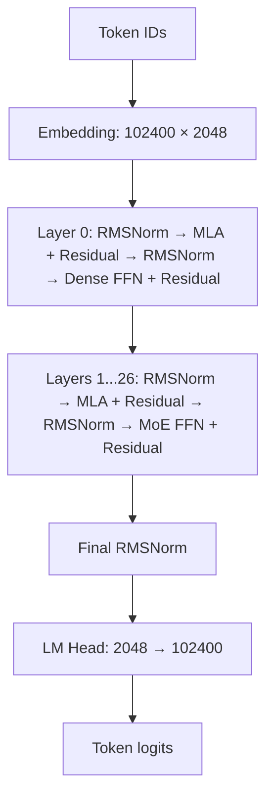
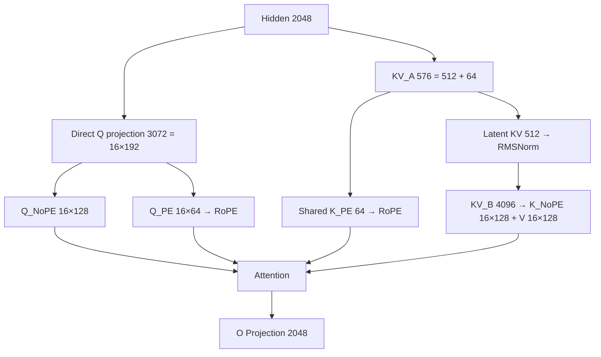
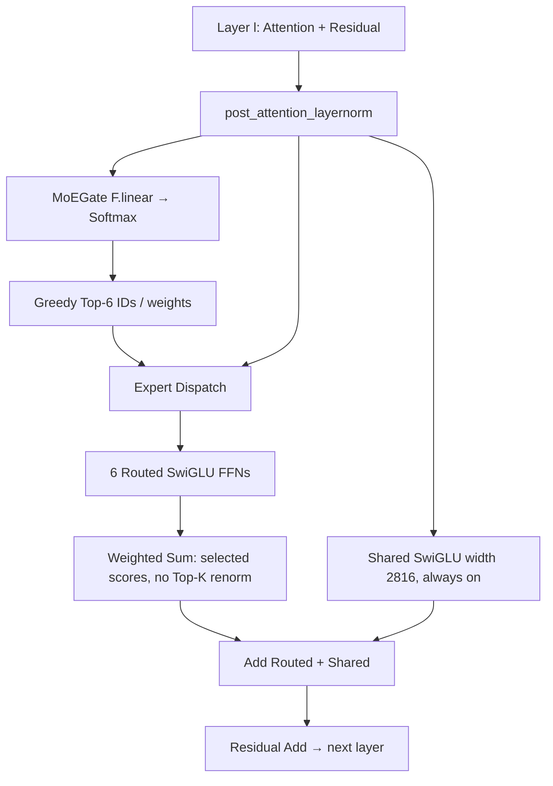

# P2-M0-1｜DeepSeek-V2-Lite-Chat 模型架构与源码技术复核报告

**调查日期：2026-11-17**  
**项目：LLM Quantization & MoE Structural Optimization（与 vLLM Stage D 分离）**  
**对象：`deepseek-ai/DeepSeek-V2-Lite-Chat`**  
**调查边界：静态配置、官方文献、源码及公开索引；未下载全部模型权重，未读取 Safetensors Tensor Header，未部署和运行模型，未编写实验代码。**

## 0. 版本、证据等级和上一版报告复核

| 对象 | 固定版本 / 文件 | 审查用途 |
|---|---|---|
| HF Chat 模型 | `85864749cd611b4353ce1decdb286193298f64c7` | `config.json`, `modeling_deepseek.py`, `model.safetensors.index.json` |
| DeepSeek GitHub | `ec98ee3cbffc32104cd55dba8af884b3d772602a` | 论文说明、官方 README；注意模型的实际 Python 实现在 HF 仓库 |
| vLLM | `v0.7.3`, commit `ed6e9075d31e32c8548b480a47d1ffb77da1f54c` | 推理实现对照，不把当前 main 混入 |
| Transformers | HF 模型仓库提供 Remote Code：`modeling_deepseek.py` | 这不是某个当前 Transformers main commit 的内置执行实现；`transformers_version=4.33.1` 是 checkpoint 元数据而非已验证运行锁定 |
| DeepSeek-V2 技术报告 | arXiv `2405.04434` | 官方模型规模和理论结构 |

证据标签：**[C]** 配置直接给出；**[S]** 所固定源码直接确认；**[I]** 权重索引明确列出；**[D]** 根据参数与 Linear 定义推导；**[H-UNKNOWN]** 需直接读取 Safetensors Header / Tensor 才能验证；**[E]** 论文作者公开实验（不是本项目复现）。

**上一版报告结论**：核心 27 层、0 号 Dense、1–26 号 MoE、64 Routed、Shared 宽度 2816、Top-6、各类预测 Shape 均合理；此前 `15,706,484,224` 参数与索引 `31,412,968,448` 字节吻合，是强一致性校验。**必须修订**：① 把先前 `2.661B` 明确标为“包含 Embedding 和非共享 LM Head 的全路径理论触达参数”而非官方 Activated Params；官方采用约 **2.4B**；② `163840` 只是位置配置，官方公布 Lite 32K 支持长度，绝非已经质量验证的 160K；③ 强制分开“MLA 架构能够缓存压缩 latent”与“HF eager/Flash 实际实现缓存展开 K/V”；④ 之前缺少固定版本、Router 插桩、方法查重、独立专家权重替换边界。实际 Header Shapes 未验证，不能称“真实权重已核准”。

## 1. 整体模型架构

官方数据 [C/S/论文]：Decoder-only Causal LM，**27 层**；Hidden=2048；Vocab=102400；16 Attention Heads；MoE 层 26 个；第 0 层的 dense FFN intermediate=10944，第 1–26 层 Routed FFN intermediate=1408；每个 MoE 层 64 个 Routed Experts + 等效 2 个 Shared Experts，Top-6。

官方标称总参数 **15.7B**，Activated Params **2.4B**。依据各层 Linear/RMSNorm/Embedding 理论计算全量 **15,706,484,224**，理论 BF16 **31,412,968,448 Bytes**，与 `model.safetensors.index.json` 的 `metadata.total_size` 匹配。注意这个值不包括激活、KV、算子工作空间及量化辅助元数据；总理论 BF16 权重为约 **29.26 GiB**。此前计算的 `2,661,150,208` 是将 embedding 和 LM head 都算作每 token 访问、再计入 6 routed + shared 路径的口径；不与官方四舍五入的 2.4B 混称。

官方模型卡/论文的 **32K** 与配置 `max_position_embeddings=163840`、YaRN `factor=40`、`original_max_position_embeddings=4096` 不同：模型声明 160K 位置范围不构成 160K 能正常长文本推理的实测证据。

所有 Decoder 层都含 MLA、input/post-attention RMSNorm 和两个 Residual；`DeepseekV2DecoderLayer.__init__` 根据 `layer_idx >= first_k_dense_replace`（1）且 `layer_idx % moe_layer_freq == 0`（1）决定 Dense/MoE。`DeepseekV2Model.forward` 顺序遍历 27 层。

## 2. MLA 结构及执行过程

### 2.1 实际配置（Lite，不得混用完整 V2）

| 参数 | Lite | 完整 DeepSeek-V2 的关键区别 |
|---|---:|---|
| `num_attention_heads` | 16 | 完整 V2 128 |
| `kv_lora_rank` | 512 | 完整 V2 也采用低秩 KV 压缩，别据此判断实现相同 |
| `q_lora_rank` | `null` | 完整 V2 为 1536；Lite 没有 `q_a_proj/q_b_proj` 路径 |
| `qk_nope_head_dim` | 128 | 实际 RoPE 之外的 Q/K 分量 |
| `qk_rope_head_dim` | 64 | 独立的旋转位置分量 |
| `v_head_dim` | 128 | 每头 V |
| Q/K 每头总维度 | 192 | 128 + 64 |

设输入 `h∈R^2048`。Lite **Query 直接投影**（不是 LoRA）：`q = W_q h ∈ R^(16×192)`，每头拆 `q_nope ∈ R^128`、`q_pe∈R^64`。KV 第一阶段 `W_kva h ∈ R^(512+64)`，拆出 `c_KV∈R^512` 与 `k_pe∈R^64`；`c_KV` 经 RMSNorm，再 `W_kvb` 生成 16 个头各自的 `k_nope∈R^128`、`v∈R^128`。RoPE **仅**作用于 `q_pe` 与 `k_pe`，然后形成 `q=[q_nope,RoPE(q_pe)]` 和 `k=[k_nope,RoPE(k_pe)]`；Attention 权重为 `softmax(q kᵀ / √192)`（实际 YaRN 分支可能修正 scaling），Attention 输出经 `W_o` 回到 2048。

### 2.2 **KV Cache 必须看执行后端**

- **架构层面的 MLA**：可以缓存每个 Token 每层约 `512 latent + 64 decoupled RoPE key = 576` 个元素，在后续 Attention 中重建/吸收权重。这是对缓存尺寸的**可实现**压缩目标，不自动代表每种软件后端的实际分配。
- **HF Remote Code 的 `DeepseekV2Attention.forward` eager 路径**：源码先展开每头 K `[B,16,T,192]` 和 V `[B,16,T,128]`，然后 `past_key_value.update(key_states, value_states, layer_idx)`。缓存的是**展开的 K/V**，不是 576 维 latent。
- **HF `DeepseekV2FlashAttention2.forward`**：在这一固定实现中，为对齐 head dims，V 可先 pad 到 192 后入缓存；缓存维度需按具体分支核查，不能直接沿用 eager 的 128。
- **vLLM v0.7.3 的 `DeepseekV2MLAAttention` 且 `use_mla=True`**：将 512 维压缩 `kv_c_normed` 和 64 维 `k_pe` 传入 MLA 后端，属于压缩型执行路径。反之 `DeepseekV2Attention` 的普通 Attention 分支构造展开的 K/V。真正占用还与后端 layout、padding、dtype 和 block size 有关。

举例：若 BF16、每 Token 每层、不考虑块对齐及元数据，576 latent 为 `1152 Bytes`；eager 展开 `(16×192 + 16×128)×2 = 10,240 Bytes`；Flash V pad 情况 `(16×192 + 16×192)×2 = 12,288 Bytes`。这些是 **Tensor 维度理论字节量**，不是 GPU 实测。GQA 只有指定 KV heads/维度/后端才可比较，例如 8 KV heads × (128 K + 128 V) × 2 bytes = 4096 Bytes，此假定配置下 latent 更小约 3.56 倍；不能把完整 V2 相对 MHA 的论文节省率直接说成 Lite 相对所有 GQA 的节省率。

源码定位：`DeepseekV2Attention.__init__/forward`、`DeepseekV2FlashAttention2.forward`；vLLM `DeepseekV2MLAAttention.__init__/forward` 与后端 `Attention(use_mla=True)`。

## 3. MoE 架构、Router 和执行路径

每层 Routed Expert 64 个，各是独立的 SwiGLU MLP：
`Expert_e(h)=W_down,e[SiLU(W_gate,e h) ⊙ (W_up,e h)]`。
Router 参数 `mlp.gate.weight` 维度 `[64,2048]`；接收 **经过 post-attention RMSNorm** 的 Token hidden `h`。`MoEGate.forward` 将门控矩阵运算转 float32，计算 `z=hW_gateᵀ∈R^64`，`s=softmax(z)`，`topk(s,6)` 得到专家 ID 和权重。配置 `topk_method='greedy'`,`n_group=1`,`topk_group=1`,`norm_topk_prob=false`,`routed_scaling_factor=1.0`，所以**只取 Top6，选中权重通常不再归一化为和 1**。不应误称完整 V2 的 group-limited greedy 分组路由适用于 Lite。

`DeepseekV2MoE.forward`：对各 Token 调用 `self.gate(hidden_states)`，`moe_infer` 根据 `topk_idx` 将 Token 排序/派给被选 Expert，Expert 输出加权，再与 `shared_experts(identity)` 结果相加。对单个 Token：**实际运行 6 个 Routed Expert + 每层 1 个宽度2816的 Shared MLP（逻辑等价2个1408专家的中间宽度）**，不是执行 8 个各自独立的 1408 MLP；Router 只控制 routed 部分。注意 Layer0 只有 Dense FFN。

### 3.1 Load balancing 的边界

HF `MoEGate.forward` 有训练分支 `self.training and aux_loss_alpha>0`；本模型 `aux_loss_alpha=0.001`,`seq_aux=true`，采用序列级辅助负载平衡形式。根据官方论文 Lite 的分布式训练布局，没有使用完整版跨设备的 device-level/communication balance losses。**推理阶段没有负载均衡训练惩罚项**，也不能据配置保证 64 个专家被均匀访问。

### 3.2 模型源码到 vLLM 代码的映射

| 功能 | HF Remote Code | vLLM v0.7.3 |
|---|---|---|
| 层选择 | `DeepseekV2DecoderLayer.__init__` | `DeepseekV2DecoderLayer.__init__` |
| Router | `MoEGate.forward`：`scores`, `topk_idx`, `topk_weight` | `DeepseekV2MoE.forward`：`router_logits` 由 `ReplicatedLinear` 输出 |
| Dispatch/计算 | `DeepseekV2MoE.moe_infer`：逐 Expert 调用 `nn.ModuleList` | `FusedMoE.forward`：融合 dispatch/专家计算；不提供逐个 Expert 的 Python hook |
| Shared | `self.shared_experts` 单个 `DeepseekV2MLP` | 同等 width，`DeepseekV2MLP`，与 fused routed 输出相加 |
| 权重载入 | checkpoint 的 3 个 MLP 矩阵 | `DeepseekV2ForCausalLM.load_weights` 将 checkpoint 映射到 fused `gate_up_proj` / FusedMoE expert 参数 |

**执行上的关键区别**：HF Python MLP 每个 Expert 可分别观测；vLLM FusedMoE 中可获取模型前向总输出，但默认不保留专家各自的 Python 张量；如需逐 Expert 输出，必须调整 kernel/backend 或在 HF 离线旁路重放。这个差异比表面模型结构差异更影响 Profiling 成本。

## 4. 权重命名与 Shape 对照表

约定：`i=0..26` 为 Layer，`l=1..26` 为 MoE Layer，`e=0..63` 为 Routed Expert；Shape 采用 PyTorch `Linear.weight=[out_features,in_features]`。下表 Shape 均属 **[D] 源码+配置推导**，**实际 Safetensors Header Shape 均为 [H-UNKNOWN]**，不把理论值冒充 Header 读取结果。

| 原 checkpoint 的权重名称（模式） | 预测 Shape [D] | 权重角色 | 实际 Header |
|---|---|---|---|
| `model.embed_tokens.weight` | `[102400,2048]` | Embedding | UNKNOWN |
| `lm_head.weight` | `[102400,2048]` | Untied LM head | UNKNOWN |
| `model.norm.weight` | `[2048]` | Final RMSNorm | UNKNOWN |
| `model.layers.{i}.input_layernorm.weight` | `[2048]` | Pre-attn RMSNorm | UNKNOWN |
| `model.layers.{i}.post_attention_layernorm.weight` | `[2048]` | Pre-FFN RMSNorm | UNKNOWN |
| `model.layers.{i}.self_attn.q_proj.weight` | `[3072,2048]` | Direct Query (Lite) | UNKNOWN |
| `model.layers.{i}.self_attn.kv_a_proj_with_mqa.weight` | `[576,2048]` | KV latent + decoupled PE | UNKNOWN |
| `model.layers.{i}.self_attn.kv_a_layernorm.weight` | `[512]` | Latent KV norm | UNKNOWN |
| `model.layers.{i}.self_attn.kv_b_proj.weight` | `[4096,512]` | KV expansion | UNKNOWN |
| `model.layers.{i}.self_attn.o_proj.weight` | `[2048,2048]` | Attention output | UNKNOWN |
| `model.layers.0.mlp.gate_proj.weight` | `[10944,2048]` | Dense gate | UNKNOWN |
| `model.layers.0.mlp.up_proj.weight` | `[10944,2048]` | Dense up | UNKNOWN |
| `model.layers.0.mlp.down_proj.weight` | `[2048,10944]` | Dense down | UNKNOWN |
| `model.layers.{l}.mlp.gate.weight` | `[64,2048]` | MoE Router | UNKNOWN |
| `model.layers.{l}.mlp.experts.{e}.gate_proj.weight` | `[1408,2048]` | Routed Expert gate | UNKNOWN |
| `model.layers.{l}.mlp.experts.{e}.up_proj.weight` | `[1408,2048]` | Routed Expert up | UNKNOWN |
| `model.layers.{l}.mlp.experts.{e}.down_proj.weight` | `[2048,1408]` | Routed Expert down | UNKNOWN |
| `model.layers.{l}.mlp.shared_experts.gate_proj.weight` | `[2816,2048]` | Shared gate | UNKNOWN |
| `model.layers.{l}.mlp.shared_experts.up_proj.weight` | `[2816,2048]` | Shared up | UNKNOWN |
| `model.layers.{l}.mlp.shared_experts.down_proj.weight` | `[2048,2816]` | Shared down | UNKNOWN |

例如要定位 **第 10 层的第 7 号 Routed Expert（均为零基）**，寻找 `model.layers.10.mlp.experts.7.gate_proj.weight`、`.up_proj.weight`、`.down_proj.weight`，使用 `model.safetensors.index.json` 的 `weight_map` 确定每个 Tensor 所在 shard。**4 个 Safetensors shards**：`model-00001-of-000004.safetensors` 至 `model-00004-of-000004.safetensors`；它们不是 64 个一一对应专家文件。

**能单独提取和替换吗？** 逻辑上可按权重 key 读取单专家三个矩阵，恢复其 MLP 计算；可以在形状一致条件下局部替换以保持原 Router ID 编号。但落地仍需：① 解析真实 Header 验 dtype/shape；② 在 shard 中定位与修改 Tensor，或模型加载后原位写入；③ 保证新版分片索引/校验、格式、量化 scale、vLLM fused 排布和 expert ID 一致；④ 替换后验证 logits/质量。**仅按现有 `index.json` 不足以证明各 Tensor 真正具有推导 Shape**。从源码没有跨 Routed Expert 的权重绑定机制，**是否恰好存在数值完全相同的张量**须读权重再测，标记 UNKNOWN。

建议固化映射记录：`(repo_revision, layer_idx, expert_id, original_tensor_key, shard_file, expected_shape, actual_shape, dtype, checksum, modified_flag)`；Router ID 不可随意重新排列，否则会改变语义。

## 5. Expert Profiling 数据获取可行性

以下是未来工程可行性审查，不代表本次已经运行。

| 所需指标 | 原生数据位置 | HF 是否直接通过公共输出获得 | vLLM v0.7.3 是否直接获得 | 需要工作 / 开销 | 是否重新进行模型前向 |
|---|---|---|---|---|---|
| Top-6 Expert IDs | `MoEGate.forward`: `topk_idx` | 否；函数内部直接存在 | 否；FusedMoE 路由内部 | HF 轻量插桩，vLLM 需暴露路由结果；存储 O(T×L×6) | 在线采集不必额外前向 |
| Router 全部概率 | `scores=softmax(logits)` | 否；中间 Tensor | 否；需从 `router_logits` 计算或导出 | 存储 O(T×L×64)；不与 `topk_weight` 混淆 | 在线采集不必重复主前向 |
| 每专家激活次数 | `topk_idx` 统计直方图 | 否，离线统计可得 | 否，需先得到 ID | 统计开销低；异步记录 | 不必 |
| 分层 Load Distribution | 各层选中 ID 频率 | 否，离线统计可得 | 否，需插桩 | 需要时间窗口、token 样本数 | 不必 |
| Expert Co-activation | 每 token 同层 6 个 ID 的两两组合 | 否，离线统计可得 | 否，需插桩 | 离线 O(T×L×6²) 级别统计 | 不必 |
| 选中 Expert 单独输出 | `DeepseekV2MoE.moe_infer` 的 `expert_out` | 默认不返回；可模块 Hook / 修改函数 | 默认 FusedMoE 不能逐 Expert 直接 Hook | 需对齐 dispatch/token 顺序；大量存储与 I/O | 在线记录可不额外主前向，但会影响性能 |
| 未选中 Expert 输出/同输入相似度 | `DeepseekV2MLP.forward` 用捕获的 `h_l` 重放 | 无原生输出 | 无原生输出 | **需要额外的 Expert FFN 计算**，取样策略决定开销 | 有输入缓存时不用重新运行完整 Transformer，但必须额外运行候选专家 |

### 公平比较输出相似度的关键

不能简单比较不同专家在自然路由中收到的不同 Token 输出：那同时改变了**输入分布**和**专家函数**，不能证明专家彼此相似。正确比较单位是**同一层、同一 Token、同一 `post_attention_layernorm` 后的 hidden state `h_l`**：

`E_i(h_l)` 与 `E_j(h_l)`，固定输入、层、精度和激活函数，计算 cosine similarity、相对 L2 误差；再分析 `w_i E_i(h_l)` 这种路由权重加权的输出贡献和下游输出差异。对未被选中的专家必须做额外的反事实（shadow）前向。高 cosine 不代表可直接替换，需同时看输出尺度、路由分布及质量。对于 64 个专家全覆盖，比仅六个候选的 FFN 计算量将显著增加。

**优选路径**：先用 HF 源码原生版拿到 Router 全分数、6 个 ID、FFN 输入和选中输出；将少量有代表性的 `h_l` 持久化，离线对选定专家对统一重放。只有在确定瓶颈和要做在线 profiling 时再修改 vLLM kernel。避免将复杂性过早推到 GPU Serving 路径。

## 6. 后续结构优化 / 量化的技术准备与已有工作

下表中的“减少权重”是实现条件判断；如果仅修改路由而保留全部 checkpoint 权重，**模型文件大小不会减少**。单 Token FFN 计算下降也不等价于整个系统端到端时延必然下降。

| 方法 | 需要动哪里 | 训练/蒸馏 | Router | Expert 权重 | MLA | 权重总量下降 | 推理计算可能下降 | Lite 直接证据 |
|---|---|---|---|---|---|---|---|---|
| **BrownoutServe / United Expert** | 专家融合代理与服务时分级替换 | United Expert 通常需要蒸馏 | 动态 brownout 决策/分派变化 | 新的联合专家；能否舍弃原专家取决部署策略 | 原架构不必改变 | **条件性** | 有可能 | **未证实**作者在 Chat checkpoint 测过，不能移植其他模型 2.07× 等结论 |
| **BrownoutMoE** | Layer-wise expert grouping + 新部署组织 | 论文有学习分组与分组一致蒸馏 | 需要适配 grouping | 需要蒸馏后结构 | 原架构不必改变 | 条件性 | 有可能 | **UNKNOWN**：截至本次查得摘要未证明在该具体 Chat checkpoint 评估 |
| **SERE** | 解码期间类似专家 reroute、动态减少访问 | 主方法设计重点为推理时重路由，非重新训练全部 FFN | **是**；分配结果变 | 可保留原 Expert 权重 | 保持 MLA | **通常否**，仍保留所有权重 | **有直接证据** | **有**：ICLR 2026 对 DeepSeekV2-Lite 做了公开实验，仓库支持 Chat；具体表格使用的 checkpoint 需核实 |
| **Expert Pruning** | 删除若干 Expert + Router 输出维度/ID 映射，或 mask | 直接剪可能无训练；性能恢复通常校准/微调 | 物理剪需改 | 删除/重排 | 保持 MLA | 是（物理删除） | 有可能 | 存在针对 Lite 的相关研究，但仍须复现实验和 baseline |
| **Expert Merging** | 依据相似性合并 FFN 参数或函数 | 可先无训练验证；通常需再校准/微调 | 必须映射/重训或适配 | 合并 | 保持 MLA | 条件性 | 有可能 | SERE 论文中 HC-SMoE 等对照可作风险证据，并非任意合并必优 |
| **MoE-to-Dense Distillation** | 以 Dense FFN 学习原 `Shared+Routed` 功能 | **需要**蒸馏 | 移除 Router | 新 FFN | 保持 MLA | 取决目标 Dense 宽度 | 取决宽度与性能 | 本次未确认 Chat 专属端到端结果 |
| **GPTQ / AWQ INT4** | 对适用的 Linear/Expert 权重做后训练量化及 Kernel/Loader 兼容 | 通常需校准，无需从头训练 | 可保留结构；若量化 Router 需单独验证 | 权重格式与 scale 改变 | **结构不变**；若量化 MLA 投影会影响数值 | 是（视覆盖率） | 内存受限且 kernel 适配时才可能 | **尚无本项目针对 Chat 的硬件实测**；要核对 vLLM+GPU 硬件算子支持 |

### 最重要的已存在实验证据：SERE（2026）

ICLR 2026 `SERE: Similarity-based Expert Re-routing for Efficient Batch Decoding in MoE Models` 的 DeepSeekV2-Lite 测试表（作者的 benchmark，**不是我们完成的实验**）报告：

| 作者实验配置 | 八项任务平均准确分数 | TPOT, QPS=16 |
|---|---:|---:|
| 原始 Top-6 | **54.76** | **26.35 ms** |
| 简单降低 Top-2 | 45.36 | 19.51 ms |
| SERE Top-2, ρ=0 | **55.12** | **21.60 ms** |
| SERE Top-2, ρ=0.3 | **55.48** | **23.12 ms** |

这直接说明 **简单减少 Top-K 可能大幅损害质量，而保留相似/关键专家的重路由存在更好的精度–延迟折中**。注意论文表格写 `DeepSeekV2-Lite`，作者代码 README 明列支持 `DeepSeek-V2-Lite-Chat`，但如需声称这些表格数值直接属于 Chat checkpoint，必须再固定其作者实验配置。

BrownoutServe 论文后来正式发表于 IEEE Transactions on Computers（2026）；其 throughput 加速数据的版本/基线与 arXiv 草稿可能不同，**禁止直接套用 Lite**。BrownoutMoE 2026.07 论文以专家分组+蒸馏为主，不能将其 2.24× 吞吐直接当成 Lite 的结果。

### 量化的重要算账边界

15.706B 参数如果理论上**全部**以纯 INT4 计，仅权重位数为 `7.85×10^9 Bytes`（约 `7.31 GiB`），但这不是一个可运行 GPTQ/AWQ 实例的显存需求：还要考虑 scale/zero、group packing、通常保留 BF16 的层、激活、KV Cache、算子工作区和量化后格式约束。**“RTX 3090 24GB 能部署”及“V100 能运行指定 fused kernel”都不由这些静态数值得出。**

## 7. 证据总表

| 技术问题 | 已确认事实 | 对应源码/配置 | 后续实验用途 | 尚待验证事项 |
|---|---|---|---|---|
| Dense/MoE 层 | Layer0 Dense；Layer1–26 MoE | `config.first_k_dense_replace`, `DeepseekV2DecoderLayer` | 选层采样 | 层间相似性差异 |
| 每层专家 | 64 Routed + 1 个等效 2 Shared 的宽度2816 MLP | `n_routed_experts`, `n_shared_experts`, `DeepseekV2MoE` | 明确观察对象 | 无需再猜专家数 |
| Token Top-K | Top-6 greedy softmax；未选中归一化 | `MoEGate.forward`, `norm_topk_prob=false` | Router/Coactivation | 不同真实负载分布 |
| Router 辅助损失 | 训练期 seq-aux 0.001；推理不加损失 | `MoEGate.forward`, `seq_aux` | 解释负载偏斜 | 实际负载测量 |
| MLA Query | `q_lora_rank=null`，直接 q_proj | `DeepseekV2Attention` | 量化分组 | 投影误差敏感性 |
| MLA KV | latent 512+rope64；HF eager 缓展开 K/V | HF `DeepseekV2Attention.forward`; vLLM MLA backend | 分离性能评估 | 实际选用后端、layout、cache 内存 |
| Expert 张量 | 3 个 FFN Linear；典型 `[1408,2048]`, `[2048,1408]` | `DeepseekV2MLP` + 配置；索引 weight_map | 提取/替换 | **Safetensors Header shape/dtype UNKNOWN** |
| Shared 张量 | 一个宽2816的 FFN | `DeepseekV2MoE` | 不误伤 Shared | 数值分析尚无 |
| 同输入相似性 | 必须统一 `post_attention_layernorm` 后的 `h_l` | `DeepseekV2DecoderLayer.forward`, `moe_infer` | 公平 profiling | 需额外反事实 Expert FFN 计算 |
| SERE 查重 | 论文已有 Lite 模型族直接实验 | ICLR 2026 Table 2; 作者 GitHub | baseline/复现 | 作者实验 checkpoint 与环境精确复核 |
| BrownoutServe | 已有 United Experts / brownout 服务研究 | IEEE TC / arXiv | 研究设计对照 | Lite Chat 直接评估 UNKNOWN |
| INT4 | 可在架构上考虑 Expert 后训练量化 | GPTQ/AWQ 算法 + serving backend | 量化 baseline | 算子、校准数据、设备兼容、质量 |

## 8. 八个问题直接结论

1. **哪些层使用 MoE？** 0 号层 Dense；1–26 号层 MoE，全部含 MLA。
2. **每个 MoE Layer 多少专家？** 64 个独立 Routed；加一个实现为宽度 2816、逻辑等效两个 1408 Shared 的 FFN。
3. **Token 选择几个 Routed？** Greedy Softmax Top-6；不把选择权重强制归一化到 1。
4. **Shared 如何计算？** 无条件对 Token 运行其 FFN，输出与 Routed 加权和相加；不参与 Router Top-6 竞争。
5. **MLA KV Cache 实际存什么？** MLA 可保存 `512 latent + 64 RoPE-key`；HF eager 当前展开 K/V 入 Cache；vLLM 0.7.3 `use_mla=True` 分支走压缩 MLA 后端。必须指定后端才能回答“实际”。
6. **能否独立提取/替换专家？** 按每层每 Expert 的三矩阵独立定位和替换，逻辑可行；要处理格式、Header、Router-ID、索引与 FusedMoE 映射。当前没有动权重验证。
7. **如何公平比较 Expert Output Similarity？** 固定同一 `post_attention_layernorm` 隐状态，对被比较的专家做离线 shadow forward；记录 cosine、L2、weighted 贡献、下游质量。只比较不同 Token 的自然 expert 输出是不公平的。
8. **最值得先做三项实验？** ① Router/Load/Coactivation trace；② 同输入的 Expert 输出相似度 + 一致性测量；③ 可复现原版 Top-6 与 SERE/简单 Top-2 的质量、延迟和内存 baseline。之后才进入结构剪枝/合并/量化组合；量化可以平行建立独立 baseline，但不可预先认定组合有收益。

## 9. 主要一手资料

**模型和官方实现**

1. [HF Chat 仓库固定 revision](https://huggingface.co/deepseek-ai/DeepSeek-V2-Lite-Chat/commit/85864749cd611b4353ce1decdb286193298f64c7)
2. [HF 配置（固定 revision）](https://huggingface.co/deepseek-ai/DeepSeek-V2-Lite-Chat/blob/85864749cd611b4353ce1decdb286193298f64c7/config.json)
3. [HF 原生 modeling_deepseek.py（固定 revision）](https://huggingface.co/deepseek-ai/DeepSeek-V2-Lite-Chat/blob/85864749cd611b4353ce1decdb286193298f64c7/modeling_deepseek.py)
4. [HF Safetensors 索引（固定 revision）](https://huggingface.co/deepseek-ai/DeepSeek-V2-Lite-Chat/blob/85864749cd611b4353ce1decdb286193298f64c7/model.safetensors.index.json)
5. [DeepSeek-V2 官方仓库（固定 Commit）](https://github.com/deepseek-ai/DeepSeek-V2/tree/ec98ee3cbffc32104cd55dba8af884b3d772602a)
6. [DeepSeek-V2 技术报告](https://arxiv.org/abs/2405.04434)
7. [vLLM v0.7.3 DeepSeekV2 实现](https://github.com/vllm-project/vllm/blob/v0.7.3/vllm/model_executor/models/deepseek_v2.py)

**直接相关方法与已有实验**

8. [SERE（ICLR 2026，论文）](https://openreview.net/forum?id=98IxaUQtMY)
9. [SERE 作者实现，README 直接支持 DeepSeek-V2-Lite-Chat](https://github.com/JL-Cheng/SERE)
10. [BrownoutServe（IEEE TC 2026）](https://ieeexplore.ieee.org/document/11357542/)
11. [BrownoutMoE（2026）](https://arxiv.org/abs/2607.04164)

**本次没有核验**：所有 `.safetensors` 的真实 Tensor Header、逐专家数值是否相同、真实 load balance、准确的量化 kernel/硬件兼容、性能与生成质量。没有把这些标记为“实验完成”。
